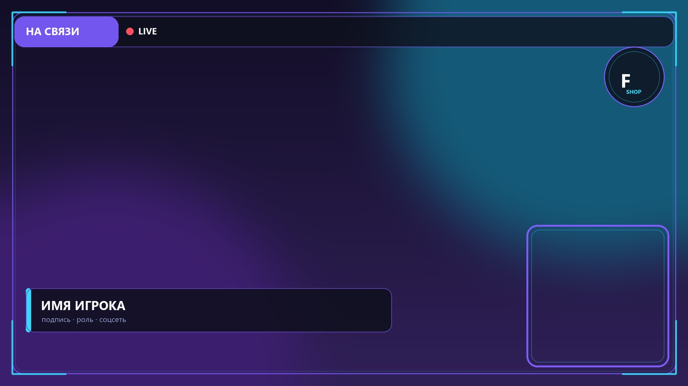

# Frolik Shop — Telegram-магазин цифровых товаров с автовыдачей

Бот продаёт цифровые товары (паки для стримов, гайды, пресеты) за рубли,
выдаёт файлы автоматически после подтверждения оплаты и умеет всё, что нужно
небольшому магазину: разделы каталога, промокоды, рефералку и учёт источников.



## Возможности

- 🛍 **Каталог с разделами** — оформление, обложки, звуки, гайды, наборы
- 💳 **Оплата в рублях** — по СБП/карте с подтверждением админом или автоматически через ЮKassa
- ⚡ **Автовыдача** — файл приходит сразу после оплаты, склад не расходуется
- 🎁 **Промокоды** — скидка на следующую покупку, лимит активаций
- 👥 **Рефералка** — 15% с покупок друга на бонусный счёт
- 📊 **Метки источников** — `?start=src_tiktok`, статистика по площадкам
- ⚙️ **Админка в боте и консоли** — товары, склад, заказы, выручка
- 📺 **Рекламный виджет для OBS** — GIF и HTML-версия

## Быстрый старт

```bash
pip install -r requirements.txt

# 1. Создайте .env
BOT_TOKEN=токен_от_BotFather
ADMIN_IDS=ваш_telegram_id
SHOP_NAME=Frolik Shop
PAY_SBP=+7 900 000-00-00
PAY_NAME=Т-Банк

# 2. Соберите ассеты (паки, обложки, виджет)
python make_assets.py

# 3. Запустите
python bot.py
```

Проверка без токена и без сети:

```bash
python bot.py --selftest
```

## Управление товарами

```bash
python admin.py add "Алерты Neon" 199 --cat "Оформление" --desc "8 GIF" --items "file:assets/alerts_neon.zip"
python admin.py stock 3 "KEY-1,KEY-2"
python admin.py price 3 149
python admin.py cat 3 "Звуки"
python admin.py list
python admin.py orders
python admin.py confirm 7
python admin.py promo TIKTOK30 30 --max 50
python admin.py sources
```

Товары-файлы указываются как `file:путь/к/архиву.zip` — бот отправит документ
и не будет списывать склад. Обычные позиции — строки с кодами.

## Оплата

- `PAYMENT_MODE=manual` (по умолчанию) — бот показывает реквизиты, клиент жмёт
  «Я оплатил», админ подтверждает, товар уходит автоматически.
- `PAYMENT_MODE=yookassa` — нужны `YOOKASSA_SHOP_ID` и `YOOKASSA_SECRET`,
  тогда оплата и выдача идут без участия админа.

## Структура

```
frolik-shop/
├─ bot.py              логика магазина, оплата, выдача
├─ admin.py            управление из консоли
├─ make_assets.py      сборка всех паков
├─ core/
│  ├─ config.py        настройки из .env
│  ├─ storage.py       SQLite: товары, склад, заказы, промо, рефералы
│  ├─ keyboards.py     кнопки и тексты
│  ├─ design.py        баннеры и обложки
│  └─ payments.py      ЮKassa
├─ pack_builder/       генераторы паков (Pillow + ffmpeg)
├─ marketing/          тексты объявлений, сценарии, картинки
└─ assets/             сгенерированные паки (в git не хранятся)
```

## Деплой

Любой VPS с Python 3.10+, `systemd`:

```ini
[Unit]
Description=Frolik Shop
After=network.target

[Service]
WorkingDirectory=/opt/frolik-shop
ExecStart=/usr/bin/python3 bot.py
Restart=always

[Install]
WantedBy=multi-user.target
```

## Безопасность

- `.env` с токеном **не коммитится** — он в `.gitignore`.
- База `data/shop.db` тоже в `.gitignore`: там заказы и данные покупателей.
- Если токен попал в переписку или репозиторий — перевыпустите его в @BotFather.

## Лицензия

Код можно использовать и дорабатывать под свой магазин. Паки и картинки —
собственная генерация проекта.
